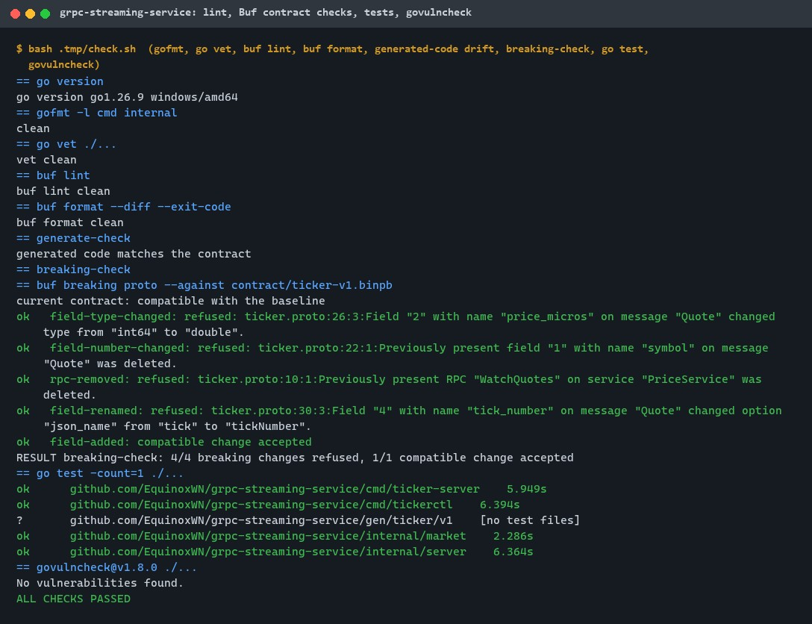
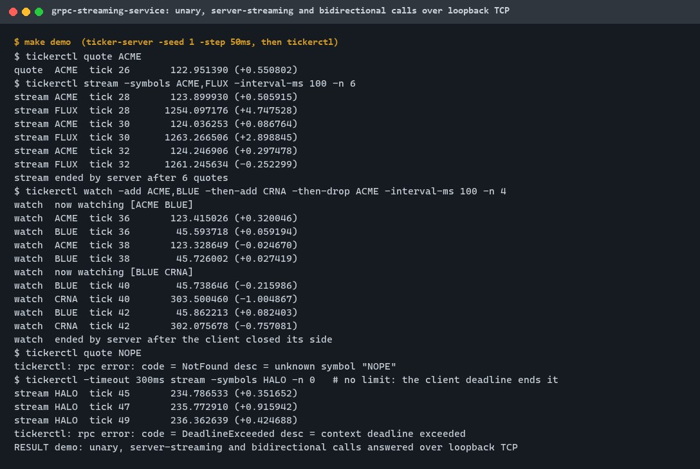
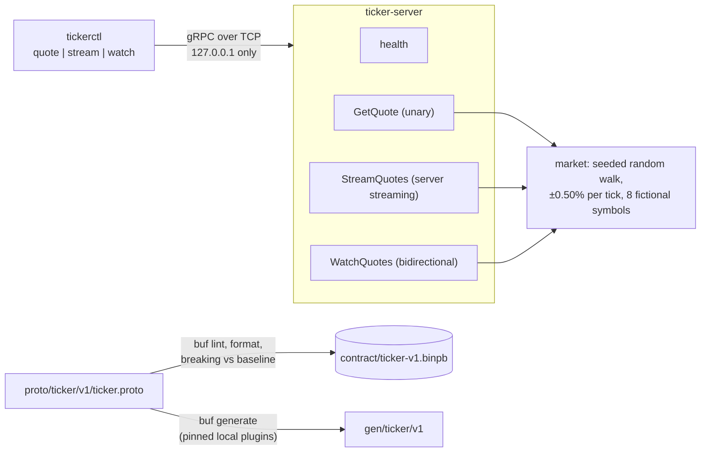
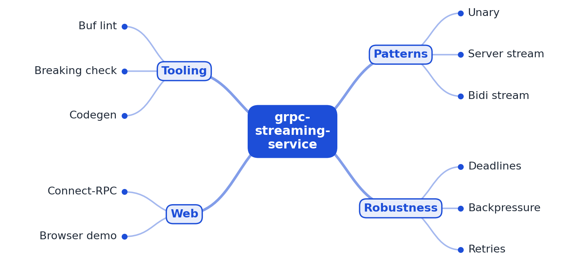

# grpc-streaming-service

[](https://github.com/EquinoxWN/grpc-streaming-service/actions/workflows/ci.yml)


> Streaming APIs whose contract cannot break by accident: a Go gRPC price ticker with unary, server-streaming and bidirectional calls, and a Buf gate in CI that refuses breaking protobuf changes.

Part of my **Backend and API** list · Go

## Proof it works

The `ticker.v1` contract lives in a Buf module. `buf lint` and `buf format` are clean, the
generated Go code matches the contract, and the breaking-change gate refuses 4 of 4 typical
breaking edits while accepting a compatible one. 15 Go tests pass and govulncheck finds nothing:



The server answers all three call shapes over loopback TCP: a unary quote, a server stream that
ends after 6 quotes, and a bidirectional watch where the client changes its symbols mid-stream.
Errors and deadlines reach the client as gRPC status codes:



## Architecture

**What M1 runs today:**



**Full roadmap (M1 to M3):**



## How it works

_Steps 1 and 2 are built and tested (M1); the rest is on the [roadmap](#roadmap)._

1. Protobuf contracts live in a Buf module with lint and breaking-change checks.
2. A price-ticker service offers unary, server-streaming and bidirectional endpoints.
3. Every call carries a deadline, and cancellation propagates to stop wasted work downstream.
4. Flow control and bounded buffers apply backpressure to slow consumers.
5. Connect-RPC lets a browser app call the same service without a separate proxy.
6. ghz load tests measure throughput and latency for each pattern.

In M1, `GetQuote` returns one quote, `StreamQuotes` sends one quote per symbol each round until
`max_updates` or cancellation, and `WatchQuotes` lets the client add and remove symbols while
quotes arrive; each change is acknowledged with the new set. Streams sample the latest price each
round instead of queueing every tick, so no per-client queue can grow
([ADR 0002](docs/adr/0002-sample-latest-price-per-round.md)). Handlers stop when the client cancels;
client deadlines already end streams (shown in the demo), and server-side deadlines are M2.

## Who it helps

- **Who:** backend engineers designing a streaming API in Go, and reviewers who need to check how
  a streaming service handles contract changes and cancelled calls.
- **The problem:** streaming services fail at the edges: a renamed field silently breaks old
  clients, a cancelled stream keeps the server busy, a client sends a huge or malformed request.
- **What M1 does:** a Buf contract with lint, format, drift and breaking-change gates (one of them
  proven against four kinds of breaking edits), and a reference service with all three gRPC call
  shapes, bounded inputs, cancellation handling and a health check, tested end to end.
- **How to use it:** copy `buf.yaml`, `buf.gen.yaml`, `scripts/breaking-check.sh` and the CI steps
  to gate your own contract; read `internal/server` for the single-sender bidirectional pattern;
  run `make demo` to watch the three call shapes.

## Tech stack

| Area | In M1 | Planned |
|---|---|---|
| Contract | Protocol Buffers in a Buf v2 module (buf v1.73.0): STANDARD lint, format, FILE-level breaking checks against a committed image and the base branch | |
| Code generation | protoc-gen-go v1.36.12 and protoc-gen-go-grpc v1.6.2, local and pinned; drift check in CI | Connect-RPC handlers (M3) |
| Service | Go 1.26, grpc-go v1.85.0: unary, server-streaming, bidirectional; health service; message, stream and keepalive limits | Server deadlines and propagation, bounded buffers (M2) |
| Client | `tickerctl` CLI with per-call deadlines | Browser client over Connect (M3) |
| Tests | Go tests on an in-memory listener and over loopback TCP; govulncheck | ghz load tests (M3) |

| Path | What it is |
|---|---|
| `proto/ticker/v1/ticker.proto` | The contract |
| `contract/ticker-v1.binpb` | Compatibility baseline (Buf image) |
| `gen/ticker/v1` | Generated Go code (committed, checked for drift) |
| `internal/market` | Seeded random-walk prices |
| `internal/server` | PriceService, server options, health |
| `cmd/ticker-server`, `cmd/tickerctl` | Server (loopback only) and CLI client |
| `scripts/get-buf.sh`, `scripts/breaking-check.sh`, `scripts/demo.sh` | Pinned tools, the breaking-change proof, the demo |

## Run it

Needs Go 1.26+, make, and bash with curl (Git Bash on Windows). Downloads and caches stay in `.tmp/`.

```bash
make setup            # Go modules, buf v1.73.0 (SHA-256 checked), code generators
make lint             # gofmt, go vet, buf lint, buf format
make generate-check   # generated code matches the contract
make breaking         # compatible with the baseline; 4 breaking edits refused
make test             # Go tests
make audit            # govulncheck v1.8.0
make demo             # server + client over loopback
```

Or step by step:

```bash
make build
.tmp/bin/ticker-server -addr 127.0.0.1:50051 -seed 1 &
.tmp/bin/tickerctl quote ACME
.tmp/bin/tickerctl stream -symbols ACME,FLUX -interval-ms 100 -n 6
.tmp/bin/tickerctl watch -add ACME,BLUE -then-add CRNA -then-drop ACME
```

Symbols: ACME, BLUE, CRNA, DYNA, ECHO, FLUX, GRID, HALO (fictional; prices are simulated).

## Tests and results

Latest local run (full detail in [docs/results/m1.md](docs/results/m1.md)):

| Test file | Tests | What it proves |
|---|---|---|
| `internal/market/market_test.go` | 4 | Deterministic per seed; lazy catch-up equals step by step; moves stay within ±0.50% and positive over 2,000 ticks; bad input refused |
| `internal/server/server_test.go` | 8 | Unary and NotFound; exact `max_updates` in order; cancel stops the handler (active streams back to 0); 7 bad requests refused; bidirectional subscribe, acknowledge, unsubscribe, clean end; oversized message refused; health SERVING |
| `cmd/tickerctl/main_test.go` | 2 | End to end over TCP for quote, stream and watch; NotFound and DeadlineExceeded reach the caller |
| `cmd/ticker-server/main_test.go` | 1 | Loopback addresses only |

| Check | Result |
|---|---|
| Tests | 15 passed, 0 failed (Go 1.26.10; streaming tests also passed 5 runs in a row; CI adds the race detector) |
| Contract | buf lint and format clean; generated code matches; compatible with the baseline |
| Breaking-change gate | 4/4 breaking edits refused (type, number, removed RPC, rename), 1/1 compatible edit accepted |
| Demo | unary, server stream (6 quotes), bidirectional watch (2 changes), NotFound, DeadlineExceeded; no process left |
| Audit | govulncheck v1.8.0: no vulnerabilities (after raising `golang.org/x/net` from v0.57.0 to v0.60.0) |
| Throughput and latency | Not measured yet (ghz, M3) |

The full local check passed twice. CI runs the same checks plus `buf breaking` against the base
branch on pull requests, and prints the demo and gate results as notices.

## Roadmap

**M1** (≈8 h)
- [x] Write `docs/rfc/0001-design.md`: problem, goals, non-goals, chosen design
- [x] Protobuf contracts live in a Buf module with lint and breaking-change checks.
- [x] A price-ticker service offers unary, server-streaming and bidirectional endpoints.

**M2** (≈8 h)
- [ ] Every call carries a deadline, and cancellation propagates to stop wasted work downstream.
- [ ] Flow control and bounded buffers apply backpressure to slow consumers.

**M3** (≈9 h)
- [ ] Connect-RPC lets a browser app call the same service without a separate proxy.
- [ ] ghz load tests measure throughput and latency for each pattern.
- [ ] Publish the proof below with real numbers

## Proof

What this repo must show before it counts as done:

- Load-test numbers and a slow-consumer demo that stays within its memory limit.

| Result | Value |
|---|---|
| Load-test numbers per call shape | Not measured yet (M3) |
| Slow-consumer demo within a memory limit | Not built yet (M2/M3) |

## Why it matters

- **Interview angle:** 'Design a real-time price or notification stream'.
- **Upstream I'd like to contribute to:** CloudWeGo Kitex (ByteDance), LINE's Armeria, or grpc-go.

## Design docs

- [RFC 0001: design](docs/rfc/0001-design.md)
- [ADR 0001: record architecture decisions](docs/adr/0001-record-architecture-decisions.md)
- [ADR 0002: stream the latest price each round instead of queueing every tick](docs/adr/0002-sample-latest-price-per-round.md)
- [ADR 0003: check breaking changes against a committed Buf image as well as the base branch](docs/adr/0003-committed-contract-baseline.md)
- [M1 results](docs/results/m1.md)

## Scope

This is a learning and portfolio system, not a hosted production service. Prices are simulated for
fictional symbols, and the server runs plaintext gRPC on loopback only.

## Security and contributing

- The server refuses non-loopback addresses (no TLS in M1) and caps message size, streams per
  connection, symbols, intervals and stream length; handlers stop on cancellation.
- buf is pinned by version and SHA-256, the generators by version; every GitHub Action is pinned to
  a commit SHA; workflows run read-only, without persisted credentials.
- Dependabot update pull requests are paused (`open-pull-requests-limit: 0`) so the repository keeps a single `main` branch; dependencies are updated by hand and checked by the CI audit.
- Report vulnerabilities privately: see [SECURITY.md](SECURITY.md). To contribute, see [CONTRIBUTING.md](CONTRIBUTING.md).

## License

MIT, see [LICENSE](LICENSE).
